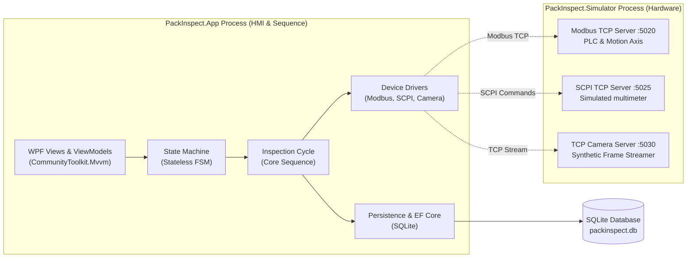
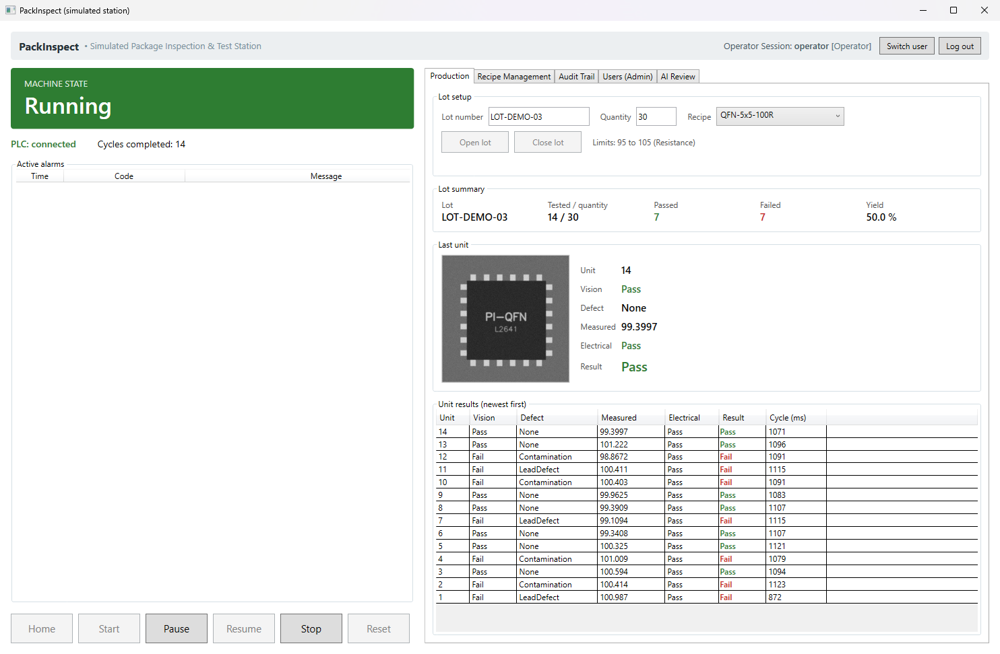
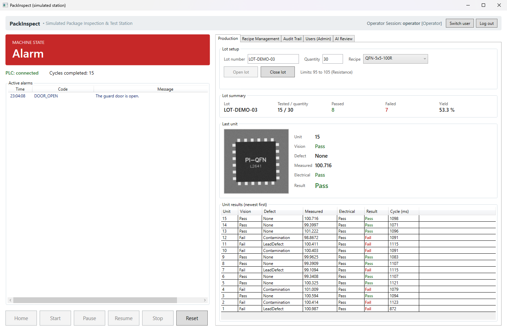
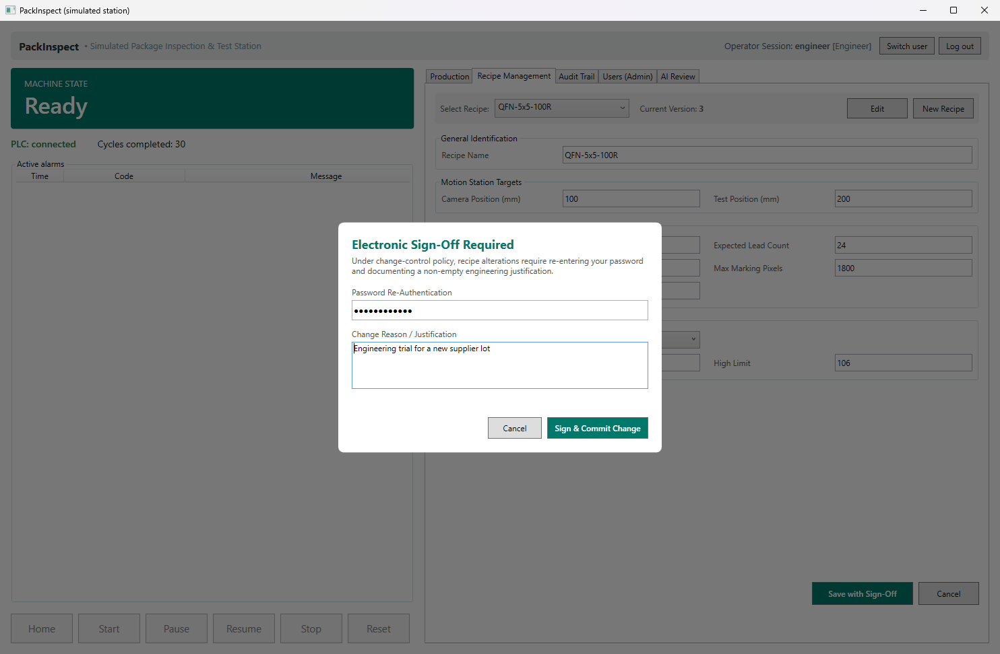
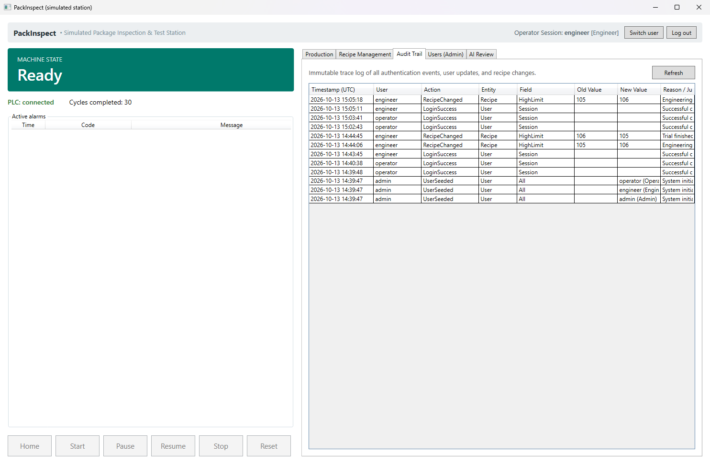
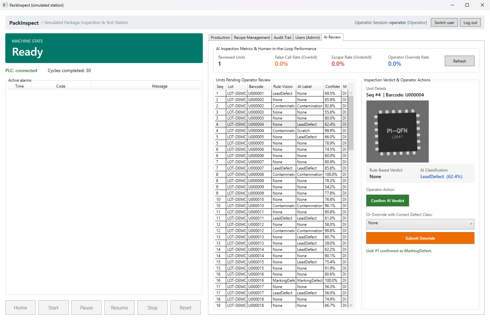

# PackInspect

[](https://github.com/luqshzeeq3601-art/PackInspect/actions)
[](LICENSE)
[](https://dotnet.microsoft.com/)

> **Simulation Notice:** PackInspect is a control software simulation of a semiconductor
> package inspection and test station. No real hardware exists. The PLC, linear motion axes,
> camera, multimeter, and barcode reader are all simulated over real network protocols
> by `PackInspect.Simulator`. Nothing here has been validated on a physical machine.

---

## 1. System Overview

PackInspect is an automated assembly and test cell controller written in modern C# (.NET 10) and WPF.
It models the final inspection and test station for a QFN-style integrated circuit package:

1. **Material Handling:** A simulated handler loads and unloads units; one linear axis positions them.
2. **Barcode Identification:** Unit barcodes are read through a legacy VB.NET driver.
3. **Optical Vision Inspection:** Rule-based OpenCV checks for chipped corners, missing leads, marking defects, scratches and contamination.
4. **Electrical Test:** Resistance or DC voltage measured through a SCPI instrument driver and compared with recipe limits.
5. **Sorting:** Each unit goes to the pass or the reject bin.
6. **AI Defect Classification:** A frozen DINOv2 Vision Transformer extracts features and an ML.NET head names the defect class. Its verdict is advisory and goes to an operator review screen.



### Screenshots

All taken from the app running against the simulator.

| | |
|---|---|
|  |  |
| A 100-unit lot running: state, lot yield, last image and results | The guard door opened in the simulator: motion stops and `DOOR_OPEN` is raised |
|  |  |
| A recipe change asks for the password again and a reason | The audit trail records who, when, old value, new value and reason |



The AI review tab lists the rule-based result next to the AI label. Good units labelled `LeadDefect` are the classifier's false calls, which is why its verdict is advisory.

---

## 2. Key Architecture & Design Decisions

* **Deterministic Finite State Machine:** Machine flow (`Idle`, `Homing`, `Ready`, `Running`, `Paused`, `Alarm`, `EStop`) is driven by `Stateless` with strict transition guards and safety interlocks (door sensors, pneumatic pressure, emergency stop).
* **Process Boundary Separation:** The simulator runs as an independent process listening on local TCP ports (Modbus TCP 5020, SCPI 5025, camera 5030). The application shares no code or address constants with the simulator, so a wrong address fails in the integration tests instead of being wrong on both sides.
* **Pure Interface Decoupling:** Core sequences depend strictly on abstractions (`IPlc`, `IMotionAxis`, `ICamera`, `IInstrument`). Concrete hardware or simulators are wired via `Microsoft.Extensions.DependencyInjection` at the application composition root.
* **Dual-Tier Vision Architecture:**
  * *Tier 1 (Deterministic OpenCV):* Threshold and contour checks against recipe limits. This tier decides the vision verdict.
  * *Tier 2 (DINOv2 ViT + ML.NET):* Frozen feature extractor (23.3 MB quantized ONNX) with an ML.NET multiclass head, on CPU. On held-out synthetic images it measures 91.7% accuracy against a 95% target, so it is advisory only; see the [test plan](docs/TEST-PLAN.md#4-ai-classifier).
* **Audited Recipe Changes:** A recipe change needs the user's password and a reason, and is stored with an insert-only audit entry holding the old and new value. It is modelled on regulated-industry practice and is not certified against any standard.

---

## 3. Project Structure

```
PackInspect/
├── src/
│   ├── PackInspect.Core/           # State machine, sequence, domain models, device interfaces
│   ├── PackInspect.Devices/        # Modbus PLC/motion, SCPI DMM, OpenCV vision, DINOv2 AI classifier
│   ├── PackInspect.Data/           # EF Core SQLite context, entities, repositories, migrations
│   ├── PackInspect.App/            # WPF desktop application, MVVM view models, composition root
│   ├── PackInspect.Simulator/      # Network servers simulating hardware with fault injection
│   └── PackInspect.LegacyDriver/   # VB.NET class library for legacy barcode reader interop
├── tests/
│   └── PackInspect.Tests/          # Unit and integration tests (xUnit v3)
├── models/                         # Not committed: DINOv2 ONNX backbone & ML.NET classifier head
└── docs/                           # Architecture, design specifications, test plans, demo scripts
```

---

## 4. Getting Started

### Prerequisites
* [.NET 10 SDK](https://dotnet.microsoft.com/)
* Windows 10/11 (for running the WPF HMI application)

### Build, Test, and Verify
Run in PowerShell from the repository root:

```powershell
# 1. Build the entire solution (warnings treated as errors)
dotnet build PackInspect.slnx

# 2. Run all unit and integration tests
dotnet test --solution PackInspect.slnx

# 3. Verify formatting and linting
dotnet format PackInspect.slnx --verify-no-changes
```

### Running the System
PackInspect requires running the simulator hardware process before launching the HMI:

1. **Start the Hardware Simulator (Terminal 1):**
   ```powershell
   dotnet run --project src/PackInspect.Simulator
   ```
2. **Start the WPF Application (Terminal 2):**
   ```powershell
   dotnet run --project src/PackInspect.App
   ```

### Default Credentials

Development-only accounts seeded into a new database. The app starts at the
login dialog; use **Switch user** to change account.

| Username | Password | Role | Permitted Actions |
|---|---|---|---|
| `operator` | `Operator123!` | **Operator** | Run lots, pause/stop cycles, review AI verdicts |
| `engineer` | `Engineer123!` | **Engineer** | Operator permissions + create and modify recipes with sign-off |
| `admin` | `Admin123!` | **Admin** | Engineer permissions + user management and viewing audit trails |

---

## 5. Engineering Documentation

* **[Architecture Guide](docs/ARCHITECTURE.md):** Detailed module boundaries, design rules, and dependency guidelines.
* **[Architecture Essentials](docs/ARCHITECTURE-ESSENTIALS.md):** One-page summary of essential engineering rules.
* **[Design Spec](docs/DESIGN-SPEC.md):** Reading guide to the design: each part, the decision behind it, and where it is defined.
* **[Test Plan & Results](docs/TEST-PLAN.md):** Test inventory, fault injection tests, and the measured AI classifier results.
* **[Demo Script](docs/DEMO-SCRIPT.md):** Step-by-step 15-minute interview demonstration walkthrough.
* **[Data Schemas & Protocols](docs/Data.md):** Modbus holding register maps, SCPI command tables, and database schemas.
* **[Security Architecture](docs/Security.md):** Password hashing, RBAC model, and input sanitization policies.

---

## 6. Open Source Licenses & Attribution

All packages and assets used in PackInspect are free and open-source (zero-cost constraint).
Packages, versions, licences and the date each was checked are listed in
[ARCHITECTURE.md §10 (Package Licences)](docs/ARCHITECTURE.md#10-package-licences).

### AI Classifier Setup (Optional)

The model files are not in version control. To run the AI classifier:

1. Download the quantized ONNX model from [onnx-community/dinov2-with-registers-small](https://huggingface.co/onnx-community/dinov2-with-registers-small) and save it as `models/dinov2_small_quantized.onnx` (about 23 MB).
2. Train the classification head. This generates 3,600 synthetic images, takes several minutes on a CPU, and writes the head and a results report into `models/`:
   ```powershell
   dotnet test --solution PackInspect.slnx --explicit only
   ```
   The run ends with a failed assertion because the measured accuracy is below the 95% target; the head and the report are still written.

Without both model files the station runs on rule-based vision alone, and the tests that need the model are reported as skipped.

## 7. Limits

* Everything runs against a simulator. No timing, noise or device behaviour of real hardware is represented.
* All images are synthetic. Nothing has been scored on real images, and no production accuracy is claimed.
* The AI classifier misses its accuracy target and is advisory only.
