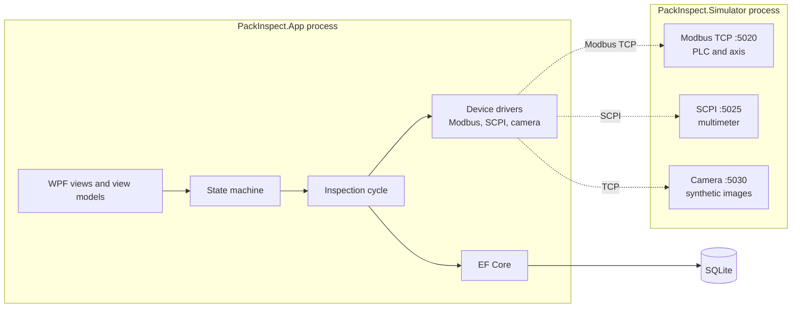
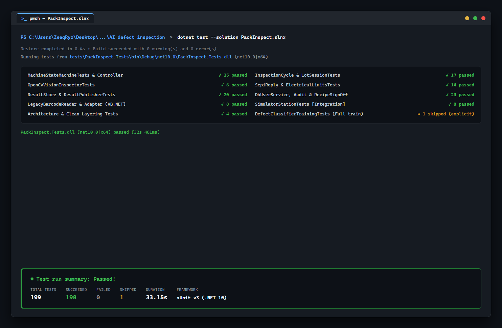
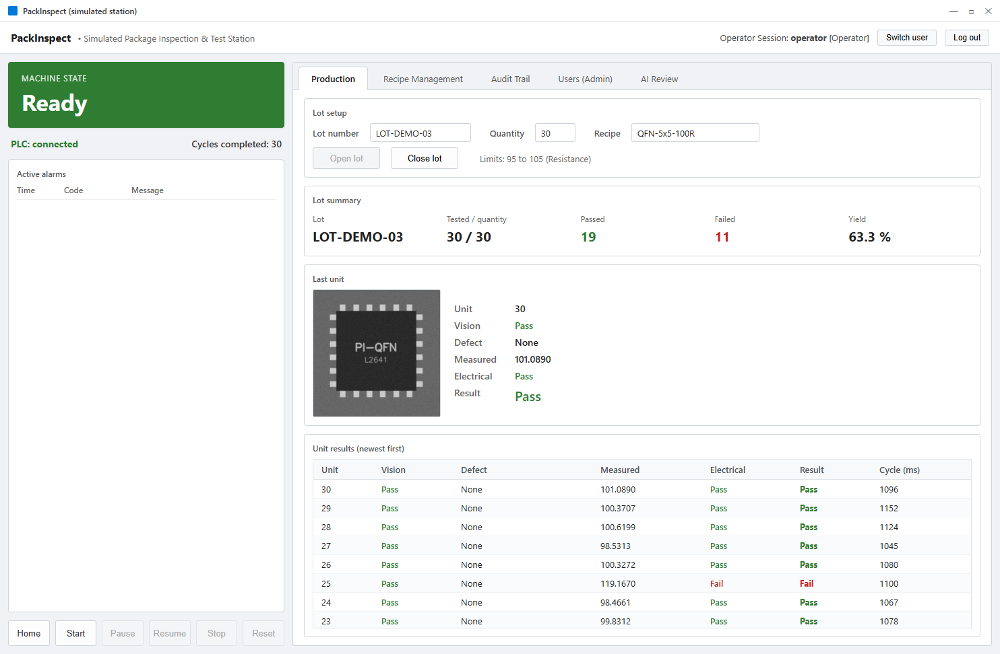

# PackInspect

[](https://github.com/luqshzeeq3601-art/PackInspect/actions)
[](LICENSE)

Control software for a **simulated** semiconductor package inspection and test
station, written in C# on .NET 10 with WPF.

> **Simulation notice:** no real hardware exists. The PLC, motion axis, camera,
> multimeter and barcode reader are played by `PackInspect.Simulator` over
> network protocols. Nothing here has been validated on a physical machine.


## Why it exists

Machine builders and test factories want engineers who have integrated PLCs,
motion, vision and instruments, but a graduate has no machine to practise on.
PackInspect is a complete station controller that runs against a software
simulator, so that work can be shown, run and explained without hardware.

## What it does

For each unit in a lot, the station:

1. loads the unit and reads its barcode (through a legacy VB.NET driver);
2. moves it under the camera and inspects the image with rule-based OpenCV
   checks: chipped corner, missing lead, marking defect, scratch, contamination;
3. moves it to the test position and measures resistance or DC voltage over
   SCPI, against the recipe limits;
4. sorts it into the pass or the reject bin and stores the result and image.

Around that cycle:

- **Machine states:** `Idle`, `Homing`, `Ready`, `Running`, `Paused`, `Alarm`,
  `EStop`, with interlocks for the guard door, air pressure and emergency stop.
- **Faults become alarms:** a device fault raises a named alarm and stops
  motion; it never crashes the app. Faults can be injected into the simulator.
- **Recipes and users:** three roles, hashed passwords, and a recipe change
  that needs the password again plus a reason.
- **Audit trail:** insert-only, with who, when, old value, new value and reason.
- **AI second opinion:** a frozen DINOv2 backbone with an ML.NET head labels
  each image for an operator review screen. It is advisory; see [Limits](#limits).

## How it is built



- **Devices behind interfaces.** The sequence and the view models know only
  `IPlc`, `IMotionAxis`, `ICamera` and `IInstrument`. The concrete drivers are
  named in one place, the composition root.
- **The simulator shares no code with the app.** Each side keeps its own copy
  of the addresses, so a wrong one fails in the integration tests instead of
  being wrong on both sides.
- **Strict MVVM.** Code-behind holds `InitializeComponent()` and nothing else.
- **Rule-based vision decides; the AI advises.** The AI label never changes how
  a unit is sorted.

| Area | Technology |
|---|---|
| UI | WPF, CommunityToolkit.Mvvm |
| State machine | Stateless |
| PLC and motion | Modbus TCP (NModbus) |
| Instrument | SCPI over TCP |
| Vision | OpenCvSharp4 |
| AI | DINOv2 ViT-S/14 (ONNX Runtime) with an ML.NET head |
| Data | EF Core, SQLite |
| Tests and CI | xUnit v3, GitHub Actions |

Packages, versions and licences:
[ARCHITECTURE.md §10](docs/ARCHITECTURE.md#10-package-licences).

## Getting started

Requirements: Windows 10 or 11, and the [.NET 10 SDK](https://dotnet.microsoft.com/).
Run everything in PowerShell from the repository root.

### Run it

Start the simulator first, then the app, each in its own terminal:

```powershell
dotnet run --project src/PackInspect.Simulator
```

```powershell
dotnet run --project src/PackInspect.App
```

Then, in the app:

1. Log in as `operator` / `Operator123!`.
2. Click **Home** and wait for the state `Ready`.
3. On the **Production** tab enter a lot number, pick a recipe, click
   **Open lot**, then **Start**.

About a third of the units fail by design: the simulator draws defects and
electrical failures at random.

To inject a fault, click the simulator terminal and press a key:

| Key | Fault |
|---|---|
| `D` | Guard door open / closed |
| `E` | Emergency stop pressed / released |
| `A` | Air pressure low / ok |
| `T` | Axis timeout on / off |
| `I` | Instrument not responding on / off |

### Accounts

Development-only accounts, seeded into a new database.

| Username | Password | Role | Can |
|---|---|---|---|
| `operator` | `Operator123!` | Operator | Run lots, review AI verdicts |
| `engineer` | `Engineer123!` | Engineer | Also change recipes, with sign-off |
| `admin` | `Admin123!` | Admin | Also manage users |

### Build and test

```powershell
dotnet build PackInspect.slnx                        # warnings are errors
dotnet test --solution PackInspect.slnx              # unit and integration tests
dotnet format PackInspect.slnx --verify-no-changes   # formatting check
```



The integration tests host the simulator in-process on free ports, so nothing
needs to be started first. CI runs the same three steps on every push, plus a
check for vulnerable packages.

### AI classifier (optional)

The model files are not in the repository. Without them the station runs on
rule-based vision alone, and the tests that need the model are reported as
skipped.

1. Download the quantized ONNX model from
   [onnx-community/dinov2-with-registers-small](https://huggingface.co/onnx-community/dinov2-with-registers-small)
   and save it as `models/dinov2_small_quantized.onnx` (about 23 MB).
2. Train the head. This generates 3,600 synthetic images, takes several minutes
   on a CPU, and writes the head and a results report into `models/`:
   ```powershell
   dotnet test --solution PackInspect.slnx --explicit only
   ```
   The run ends with a failed assertion, because the measured accuracy is below
   the 95% target. The head and the report are still written.

## Screenshots

All taken from the app running against the simulator.

| | |
|---|---|
|  |  |
| Production tab after completing a 30-unit lot with 63.3% yield and defect sorting | The guard door opened in the simulator: motion stops and `DOOR_OPEN` is raised |
|  |  |
| A recipe change asks for the password again and a reason | The audit trail records who, when, old value, new value and reason |
|  | |
| The AI label next to the rule-based result. Good units labelled `LeadDefect` are the classifier's false calls | |

## Limits

- **Simulation only.** No timing, noise or device behaviour of real hardware is
  represented.
- **Synthetic images only.** Nothing has been scored on real images, and no
  production accuracy is claimed.
- **The AI classifier misses its target.** On held-out synthetic images it
  measures 91.7% accuracy against a 95% target, and it rejects more good units
  than the rule-based check. Numbers and the reason:
  [test plan §4](docs/TEST-PLAN.md#4-ai-classifier).
- **Demonstration security.** The seeded accounts have published passwords and
  the SQLite file is not encrypted. See [Security.md](docs/Security.md).

## Project layout

```
src/
  PackInspect.Core/           State machine, sequence, domain models, device interfaces
  PackInspect.Devices/        Modbus, SCPI and camera drivers, OpenCV vision, AI classifier
  PackInspect.Data/           EF Core context, entities, stores, migrations
  PackInspect.App/            WPF views, view models, composition root
  PackInspect.Simulator/      Simulated PLC, axis, multimeter and camera with fault injection
  PackInspect.LegacyDriver/   VB.NET barcode reader
tests/
  PackInspect.Tests/          Unit and integration tests
docs/                         Architecture, data definitions, test plan, demo script
```

## Documentation

| Document | Contents |
|---|---|
| [Architecture](docs/ARCHITECTURE.md) | How it is built and why; package licences |
| [Architecture essentials](docs/ARCHITECTURE-ESSENTIALS.md) | The rules that must never be broken |
| [Design spec](docs/DESIGN-SPEC.md) | Reading guide: each part, its key decision, where it is defined |
| [Data](docs/Data.md) | Modbus map, SCPI commands, camera protocol, database schema, result payload |
| [Test plan and results](docs/TEST-PLAN.md) | Test inventory, fault injection tests, measured classifier results |
| [Security](docs/Security.md) | Password hashing, roles, input validation, honest limits |
| [Demo script](docs/DEMO-SCRIPT.md) | A 10 to 15 minute walkthrough |
| [Product requirements](docs/PRD.md) | Objectives, scope, model and dataset choices |

## Licence

[MIT](LICENSE). The DINOv2 weights are Apache-2.0 and are downloaded
separately; they are not redistributed here.
