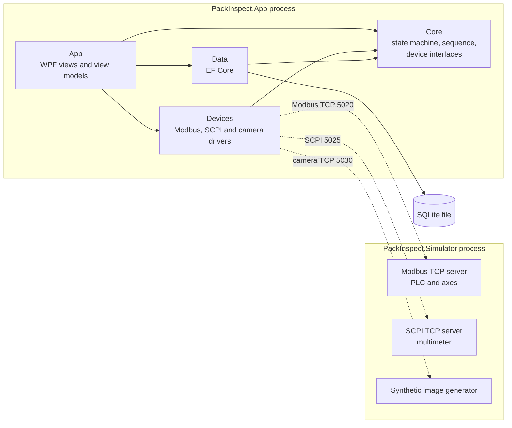
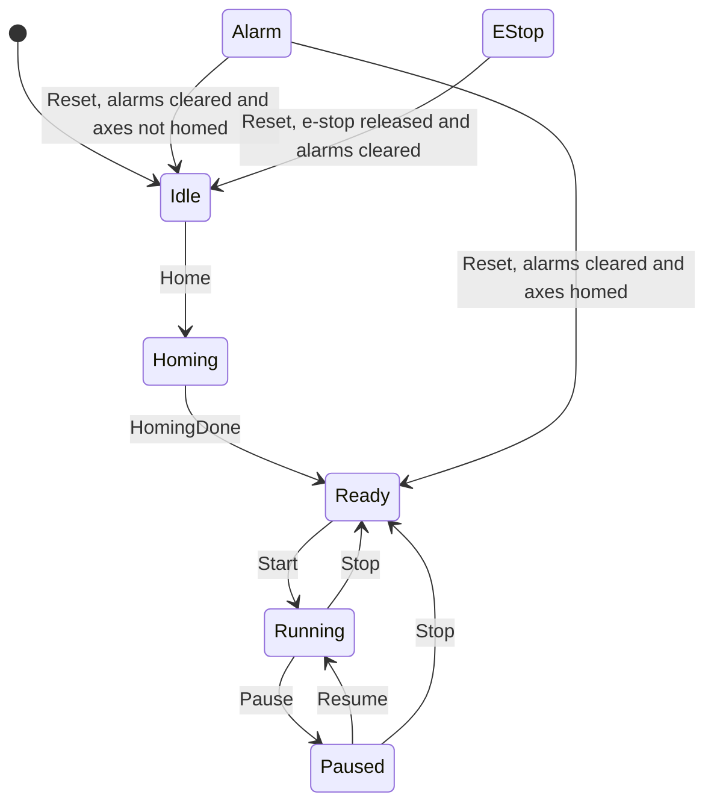
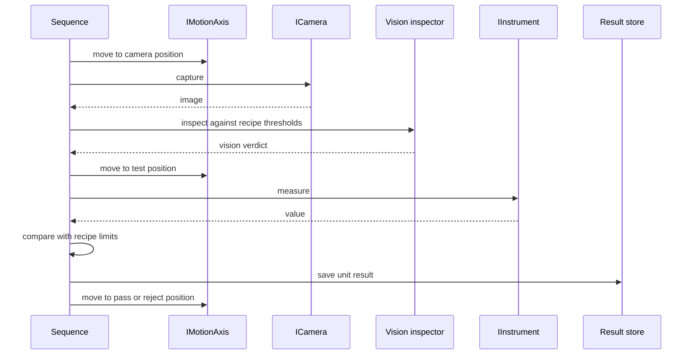

# Architecture

How PackInspect is built and why. The one-page rule list is
[ARCHITECTURE-ESSENTIALS.md](ARCHITECTURE-ESSENTIALS.md); product goals are in
[PRD.md](PRD.md); schemas and protocol maps are in [Data.md](Data.md).

Sections marked *planned* describe a later phase and are updated when it is built.

## 1. Overview

Two processes talk over the same protocols a real machine would use.



Replacing the simulator with a real machine means writing new classes in
`Devices` and changing the registrations in the `App` composition root. `Core`
and the views do not change.

## 2. Projects

| Project | Target | Contains | May reference |
|---|---|---|---|
| `src/PackInspect.Core` | net10.0 | State machine, sequence, domain models, device interfaces | nothing |
| `src/PackInspect.Devices` | net10.0 | `ModbusPlc`, `ModbusMotionAxis`, SCPI instrument, camera, barcode | Core, LegacyDriver |
| `src/PackInspect.Data` | net10.0 | EF Core context, entities, recipes, results, users, audit trail | Core |
| `src/PackInspect.App` | net10.0-windows | WPF views, view models, composition root | Core, Devices, Data |
| `src/PackInspect.Simulator` | net10.0 | Console app that plays the hardware, with fault injection | nothing |
| `src/PackInspect.LegacyDriver` | net10.0 | VB.NET barcode reader (phase 4) | nothing |
| `tests/PackInspect.Tests` | net10.0 | Unit and integration tests | Core, Devices, Data, Simulator, LegacyDriver |

Why the split:

- **Core has no dependencies**, so the machine rules can be unit-tested in
  milliseconds with fake devices and no window, socket or database.
- **The simulator shares no code with the app.** If it reused the app's address
  constants, a wrong address would be wrong on both sides and still "work". Each
  side keeps its own copy, as it would against a real PLC, and the integration
  tests catch a mismatch.
- **Tests reference the simulator** so integration tests can host it in-process
  on a free port instead of depending on a separately started program.

Folder layout inside the projects:

```
src/PackInspect.Core/       Devices/  Machine/  Alarms/  Sequence/  Domain/  Auth/  Audit/  Ai/  Publishing/
src/PackInspect.Devices/    Modbus/  Scpi/  Camera/  Net/  Vision/  Barcode/  Ai/  Publishing/
src/PackInspect.Data/       Entities/  Migrations/  Auth/  Audit/  Alarms/
src/PackInspect.Simulator/  Plc/  Instrument/  Imaging/  Units/  Net/
src/PackInspect.App/        Views/  ViewModels/  Converters/
tests/PackInspect.Tests/    Unit/  Integration/  Fakes/
```

## 3. Machine state machine



Not drawn, to keep the diagram readable:

- `AlarmRaised` moves **any state except EStop** to Alarm.
- `EStopPressed` moves **any state** to EStop.

Decisions:

- **Reset from EStop always returns to Idle.** On a real machine an emergency
  stop removes drive power, so the axis position can no longer be trusted and
  homing is required again.
- **Reset from Alarm returns to Ready only if the axes are still homed.** A door
  alarm during a run keeps the position; a homing timeout does not. On Reset the
  controller asks the axis for its homed status instead of assuming, so a PLC
  that was power-cycled during the fault sends the machine back to Idle.
- **Reset is refused while a fault condition is still present.** Alarms latch:
  closing the door does not clear the alarm, the operator must acknowledge it.
- **Pause is a cycle stop**: it takes effect after the current unit. Stop,
  alarms and e-stop cancel immediately.
- **Unhandled triggers are logged and ignored**, so a late button press cannot
  throw or corrupt the state.

`MachineStateMachine` wraps the Stateless library and contains only the table
above. `MachineController` owns it and does the work around it: polling the
interlocks, raising alarms, and starting and cancelling the homing and cycle
activities.

## 4. Machine cycle



The sequence is one class, `Core/Sequence/InspectionCycle`, that depends only on
interfaces. The unit is loaded at the load position (0 mm) and unloaded into the
pass or reject bin by the handler; the result and the image are saved last.

- **A unit is good only if both checks pass.** The electrical test still runs on
  a visually bad unit, so the record shows everything that was wrong with it.
- **Every device failure becomes a named alarm.** Each step is wrapped so that a
  timeout or I/O error is turned into a `MachineFaultException` carrying the
  alarm code for that device (`AXIS_MOVE_TIMEOUT`, `CAMERA_NO_RESPONSE`,
  `INSTRUMENT_NO_RESPONSE`, ...). The controller raises that alarm.
- **Cancellation is never a fault.** Stop, an alarm or an e-stop cancels the
  cycle's token; whatever the interrupted step throws on the way out is ignored.
- **An interrupted unit is not recorded.** It is discarded when the next unit
  loads, so the database only holds units that were fully inspected and tested.
- **Lots.** `LotSession` holds the open lot, its recipe and running counts. The
  machine can only start with an open lot, and stops itself when the lot's
  quantity has been tested.
- **The simulator checks the sequence.** Its camera only shows the unit at the
  camera position and its multimeter only reads it at the test position, so a
  sequence that skipped a move would fail.
- **Publishing.** Each saved result is also handed to `IResultPublisher`. The
  composition root registers `FileResultPublisher` (JSON files under
  `data/published`) unless `FabTrace:Enabled` is true in `appsettings.json`,
  in which case it registers the HTTP adapter. The payload is in
  [Data.md](Data.md#6-published-result-payload--built).

### Rule-based vision inspection

`Devices/Vision/OpenCvVisionInspector` uses the three brightness levels of the
image (dark body, mid-grey carrier, bright leads and marking). Four checks run
in order and the first that fails names the defect; the limits come from the recipe.

| Check | Measurement | Recipe limit | Defect named |
|---|---|---|---|
| Body shape | Body pixels / area of the best-fit rectangle | `MinBodyRectangularity` | CrackChip |
| Leads | Bright blobs outside the body | `ExpectedLeadCount` | LeadDefect |
| Marking | Bright pixels in the marking window | `MinMarkingPixels`, `MaxMarkingPixels` | MarkingDefect, Contamination |
| Surface | Bright pixels on the body outside the marking | `MaxDefectAreaPx` | Scratch or Contamination, by shape |

Measured on 1,000 generated images per class with the seeded recipe limits:

| Class drawn | Rejected | Note |
|---|---|---|
| Good | 0.0% | No false calls |
| CrackChip, LeadDefect, MarkingDefect | 100% | Always named correctly |
| Scratch | 92.8% | 7.2% escape; a quarter are named Contamination |
| Contamination | 85.5% | 14.5% escape |

The escapes are small defects that lie on top of the marking, where a bright
defect cannot be told from bright text by thresholding. This is a real limit of
rule-based inspection, it is stated rather than hidden, and it is the gap the AI
inspection in phase 5 is meant to close. These numbers are for synthetic images
only and say nothing about real parts.

## 5. Threading and cancellation

| Work | Runs on | Stopped by |
|---|---|---|
| Button commands, property updates | UI thread | – |
| Interlock monitor (polls the PLC) | Thread pool, `PeriodicTimer` loop | App shutdown token |
| Homing activity | Thread pool task | Its own token, cancelled on leaving Homing |
| Cycle loop | Thread pool task | Its own token, cancelled on leaving Running or Paused |

- Each activity has its own `CancellationTokenSource`. Leaving the state cancels
  it, which is how an alarm or e-stop stops motion immediately.
- `Core` raises plain .NET events. The view model marshals them to the UI thread
  with the `SynchronizationContext` it captured when it was created, so `Core`
  needs no WPF type and the view model stays testable.
- One Modbus connection is shared by the PLC and axis drivers behind a
  `SemaphoreSlim`, because Modbus TCP is strictly request then response.
- NModbus calls take no `CancellationToken`. Cancellation is honoured while a
  request waits its turn; a request already on the wire is allowed to finish,
  bounded by the request timeout (1 s), so the next request never reads a stale
  reply. A failed or timed-out request closes the connection and the monitor
  reconnects.

## 6. Alarms and errors

- An alarm has a code, a message and the time it was raised. Codes are constants
  in `Core/Alarms/AlarmCodes.cs` and are listed in [Data.md](Data.md).
- Drivers throw on a failed or timed-out request. `MachineController` catches at
  the activity boundary, raises the matching alarm and logs the exception.
- A stale PLC heartbeat or a failed read raises `PLC_COMMS_LOST`. Losing sight
  of the interlocks is itself unsafe, so it is treated as a fault.
- Logging uses Serilog to a rolling file. Passwords and secrets are never logged
  (see [Security.md](Security.md)).

## 7. User interface

- One `MainWindow`. Left: state banner, connection indicator, alarm list and the
  Home, Start, Pause, Resume, Stop, Reset buttons (`MainViewModel`). Right: five
  tabs, each with its own view model.

  | Tab | View model | Shows |
  |---|---|---|
  | Production | `LotViewModel` | Lot setup, lot summary with yield, last unit with its image, result list |
  | Recipe Management | `RecipeEditorViewModel` | Recipe fields; saving opens the sign-off dialog |
  | Audit Trail | `AuditTrailViewModel` | The insert-only audit entries |
  | Users (Admin) | `UserManagementViewModel` | Accounts, unlock, deactivate, create |
  | AI Review | `ReviewViewModel` | AI verdicts waiting for an operator, with the unit image and the review metrics |

- The app starts at the login dialog (`AuthViewModel`). Nobody is signed in
  automatically, and a lot cannot be opened or a review submitted without a user.
- The camera image reaches the screen through a value converter in the view
  layer, so view models never hold a WPF imaging type. The review screen gets a
  file path from `IImageStore` for the same reason.
- Passwords are typed into a `PasswordBox`. WPF does not let its password be
  bound, so `Views/PasswordBoxBinding` is a small attached property that copies
  it to the view model; the code-behind stays empty.
- View models use CommunityToolkit.Mvvm source generators
  (`[ObservableProperty]`, `[RelayCommand]`). A command's `CanExecute` asks the
  state machine whether the trigger is allowed, so invalid buttons are disabled
  by the same rule that would reject them.
- `App.xaml.cs` is the composition root: it builds the generic host, registers
  the concrete devices, and opens the window. It is the only place that names a
  concrete driver.

## 8. AI inspection (built, phase 5)

- A frozen DINOv2 ViT-S/14 backbone (ONNX) turns an image into a 384-number
  embedding. A small classifier head trained with ML.NET turns the embedding
  into a defect class. The backbone runs through ONNX Runtime; the head is
  loaded as an ML.NET model file (the fallback PRD section 6 allows). Both sit
  behind an `IDefectClassifier` interface in `Core`.
- **The AI verdict is advisory.** The cycle classifies the image after the unit
  result is saved and stores the label for the operator's review screen. It
  never changes the pass or reject decision; rule-based vision and the
  electrical test do that.
- The classifier is registered only when both the backbone and the trained
  head are in `models/`. Without them the station runs on rule-based vision
  alone; a backbone with no head would call every unit good.
- Measured accuracy, false-call and escape rates are in
  [TEST-PLAN.md](TEST-PLAN.md).
- The reasoning, the alternatives that were rejected and the dataset are in
  [PRD.md](PRD.md#6-deep-learning-model).

## 9. Technology stack

| Area | Choice | Why |
|---|---|---|
| Language and runtime | C# on .NET 10 | What the target employers use |
| UI | WPF + CommunityToolkit.Mvvm | Standard for Windows machine HMIs; generated MVVM code keeps view models short |
| State machine | Stateless | The configuration reads like the state diagram |
| PLC and motion link | NModbus (Modbus TCP) | Open protocol; client and server in one library, so the simulator is a genuine Modbus device |
| Instrument link | TCP sockets + SCPI text | How bench multimeters are driven; needs no library |
| Vision | OpenCvSharp4 | Rule-based inspection and image preprocessing |
| Data | EF Core + SQLite | SQL with migrations and no server to install |
| Logging | Serilog | Structured logs to file |
| DI and configuration | Microsoft.Extensions.Hosting | Constructor injection and `appsettings.json` |
| Tests | xUnit v3 on Microsoft.Testing.Platform | Current xUnit line; built-in `Assert` only |
| AI training / inference | ML.NET / ONNX Runtime | Train the head in C# with ML.NET; run the backbone with ONNX Runtime (phase 5 only) |
| Legacy interop | VB.NET class library | Shows work with older code (phase 4) |
| CI | GitHub Actions on `windows-latest` | Free for public repositories (phase 4) |

Excluded by project rule: FluentAssertions, MediatR, AutoMapper.

## 10. Package licences

Read from each package's nuspec on NuGet. A package is added to this table
before it is referenced.

| Package | Version | Licence | Checked | Status |
|---|---|---|---|---|
| xunit.v3 | 4.0.2 | Apache-2.0 | 2026-10-13 | In use |
| CommunityToolkit.Mvvm | 8.4.2 | MIT | 2026-10-13 | In use |
| Stateless | 5.20.1 | Apache-2.0 | 2026-10-13 | In use |
| NModbus | 3.0.83 | MIT (licence file in package and repository) | 2026-10-13 | In use |
| Serilog | 4.4.0 | Apache-2.0 | 2026-10-13 | In use |
| Serilog.Sinks.File | 7.0.0 | Apache-2.0 | 2026-10-13 | In use |
| Serilog.Extensions.Hosting | 10.0.0 | Apache-2.0 | 2026-10-13 | In use |
| Microsoft.Extensions.Hosting | 10.0.12 | MIT | 2026-10-13 | In use |
| Microsoft.Extensions.Logging.Abstractions | 10.0.12 | MIT | 2026-10-13 | In use |
| OpenCvSharp4 | 4.13.0.20260627 | Apache-2.0 | 2026-10-13 | In use |
| OpenCvSharp4.runtime.win | 4.13.0.20260627 | Apache-2.0 | 2026-10-13 | In use (native OpenCV for Windows) |
| Microsoft.EntityFrameworkCore.Sqlite | 10.0.12 | MIT | 2026-10-13 | In use |
| Microsoft.EntityFrameworkCore.Design | 10.0.12 | MIT | 2026-10-13 | Build-time only |
| dotnet-ef (local tool, `dotnet-tools.json`) | 10.0.12 | MIT | 2026-10-13 | Creates migrations |
| Microsoft.ML | 4.0.1 | MIT | 2026-10-13 | In use (phase 5 classifier pipeline) |
| Microsoft.ML.OnnxRuntime | 1.20.1 | MIT | 2026-10-13 | In use (phase 5 ONNX inference) |

Models and datasets (phase 5):

| Asset | Licence | Note |
|---|---|---|
| DINOv2 ViT-S/14 weights (`facebook/dinov2-small`) | Apache-2.0 | The ONNX conversion on Hugging Face carries no licence tag of its own; it is a format conversion of these weights |
| VisA dataset | CC BY 4.0 | Not used: evaluation on it is future work. Per Amazon's repository and the AWS Open Data Registry; attribution required if it is added |
