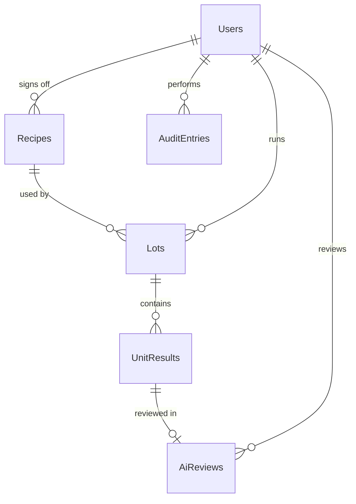

# Data models, schemas and payloads

The single definition of every structure that crosses a module boundary: the
database, the Modbus map, the SCPI commands and the published result. Change
this document and the code in the same commit.

Status of each section: **built** (matches the code) or **planned** (design for
a later phase; details may change when it is implemented).

## Conventions

- Timestamps are UTC, stored as ISO 8601 text; column names end in `Utc`.
- Physical values are SI and the unit is in the name: `PositionMm`, `LimitOhm`.
- Numbers are parsed and formatted with the invariant culture.
- Enums are stored as text, so the database is readable without the code.
- Primary keys are `Id INTEGER` (auto-increment).
- Modbus addresses are zero-based protocol addresses, not "40001"-style numbers.

## 1. Device contracts in Core – built

| Type | Members |
|---|---|
| `IPlc` | `ConnectAsync`, `DisconnectAsync`, `ReadInputsAsync` -> `PlcInputs`, `ResetFaultsAsync`, `LoadUnitAsync`, `UnloadUnitAsync(SortBin)` |
| `PlcInputs` | `EStopOk`, `DoorClosed`, `AirPressureOk` (true = healthy), `Heartbeat` |
| `SortBin` | `Pass` = 1, `Reject` = 2 |
| `IMotionAxis` | `Name`, `IsHomedAsync`, `HomeAsync`, `MoveAbsoluteAsync(positionMm, speedMmPerSec)`, `StopAsync` |
| `ICamera` | `CaptureAsync` -> `CapturedImage` |
| `CapturedImage` | `Width`, `Height`, `Pixels` (8-bit grayscale, row by row) |
| `IInstrument` | `ConnectAsync`, `DisconnectAsync`, `IdentifyAsync`, `MeasureAsync(MeasurementKind)` |
| `MeasurementKind` | `DcVoltage`, `Resistance` |
| `IVisionInspector` | `Inspect(CapturedImage, VisionSettings)` -> `VisionResult` |
| `IResultStore`, `IRecipeStore`, `IImageStore` | Persistence, implemented in `Data` and `Devices` |
| `MachineState` | `Idle`, `Homing`, `Ready`, `Running`, `Paused`, `Alarm`, `EStop` |

## 2. Modbus TCP map – built

Server: the simulator, `127.0.0.1:5020`, unit id 1.

| Table | Address | Signal | Direction | Meaning |
|---|---|---|---|---|
| Discrete input | 0 | EStopOk | PLC -> app | 0 = emergency stop pressed |
| Discrete input | 1 | DoorClosed | PLC -> app | 0 = guard door open |
| Discrete input | 2 | AirPressureOk | PLC -> app | 0 = air pressure low |
| Input register | 0 | Heartbeat | PLC -> app | Counter that increments while the PLC runs |
| Discrete input | 10 | UnitPresent | PLC -> app | 1 = a unit is on the carrier |
| Coil | 0 | FaultReset | app -> PLC | Set to clear latched PLC faults |
| Coil | 10 | LoadUnitCommand | app -> PLC | Set to have the handler place the next unit |
| Coil | 11 | UnloadUnitCommand | app -> PLC | Set to have the handler remove the unit into the bin in holding register 10 |
| Holding register | 10 | SortBin | app -> PLC | 1 = pass bin, 2 = reject bin; written before the unload command |
| Coil | 100 | AxisX.HomeCommand | app -> PLC | Set to start homing |
| Coil | 101 | AxisX.MoveCommand | app -> PLC | Set to move to the target in holding registers 100-102 |
| Coil | 102 | AxisX.StopCommand | app -> PLC | Set to abort the current move |
| Holding register | 100-101 | AxisX.TargetPosition | app -> PLC | Micrometres, signed 32-bit, high word first |
| Holding register | 102 | AxisX.Speed | app -> PLC | mm/s |
| Discrete input | 100 | AxisX.Homed | PLC -> app | 1 = position reference is valid |
| Discrete input | 101 | AxisX.Busy | PLC -> app | 1 = axis is homing or moving |
| Discrete input | 102 | AxisX.InPosition | PLC -> app | 1 = homed, stopped and at the target |
| Discrete input | 103 | AxisX.Fault | PLC -> app | 1 = drive fault, for example a move commanded before homing |
| Input register | 100-101 | AxisX.ActualPosition | PLC -> app | Micrometres, signed 32-bit, high word first |

Rules that both sides follow:

- **Command handshake.** The app sets a command coil; the PLC clears it when it
  has accepted the command. The app waits for that before reading status, so
  status always belongs to the command just sent.
- **Fail-safe interlocks.** 1 = healthy, so a dead connection or a broken wire
  reads as a fault.
- **Station positions.** The camera sees the unit only at 100.000 mm and the
  multimeter contacts it only at 200.000 mm (tolerance 0.05 mm).

## 2a. Camera protocol – built

Server: the simulator, `127.0.0.1:5030`, TCP.

| Direction | Content |
|---|---|
| app -> camera | `CAPTURE\n` |
| camera -> app | `IMAGE <width> <height>\n`, then width x height bytes: 8-bit grayscale, row by row |

Any other command gets the single line `ERROR unknown command`. The app
refuses a header it cannot parse and any dimension above 4096. Images
from the simulator are 320 x 320. With no unit under the camera the image shows
an empty carrier.

## 3. Alarm codes – built

| Code | Raised when | Clears when |
|---|---|---|
| `DOOR_OPEN` | `DoorClosed` is false | Door closed, then Reset |
| `AIR_PRESSURE_LOW` | `AirPressureOk` is false | Pressure restored, then Reset |
| `PLC_COMMS_LOST` | A PLC read fails or the heartbeat stops changing | Communication restored, then Reset |
| `AXIS_HOME_TIMEOUT` | Homing does not complete in the configured time | Reset |
| `AXIS_MOVE_TIMEOUT` | A positioning move does not complete in the configured time | Reset |
| `AXIS_FAULT` | Homing or a move fails for another reason, for example a drive fault | Reset |
| `HANDLER_FAULT` | Loading or unloading a unit fails | Reset |
| `CAMERA_NO_RESPONSE` | The camera does not deliver an image | Reset |
| `UNIT_NOT_FOUND` | The image shows no unit under the camera | Reset |
| `INSTRUMENT_NO_RESPONSE` | The multimeter does not answer, or answers with something that is not a number | Reset |
| `RESULT_NOT_SAVED` | The unit result or its image could not be stored | Reset |
| `BARCODE_READER_FAULT` | The barcode reader fails to scan or deliver a valid barcode | Reset |
| `CYCLE_FAULT` | The cycle fails in a way none of the above covers | Reset |

Emergency stop is a machine state, not an alarm code. A unit whose cycle is
interrupted by an alarm is not recorded and is discarded when the next unit loads.

## 4. SCPI command set – built

Server: the simulator, `127.0.0.1:5025`, ASCII text, one command per line,
terminated by `\n`. A reading of `+9.90000000E+37` is the SCPI overload value: it
is what an open circuit, or no unit at the test position, returns.

| Command | Reply | Example reply |
|---|---|---|
| `*IDN?` | Manufacturer, model, serial, firmware | `PACKINSPECT,SIM-DMM,0001,1.0` |
| `*RST` | none | |
| `MEAS:VOLT:DC?` | Voltage in volts | `+3.29871200E+00` |
| `MEAS:RES?` | Resistance in ohms | `+9.98700000E+01` |
| `SYST:ERR?` | Error number and text | `0,"No error"` |

## 5. Database – Recipes, Lots, UnitResults, Users, AuditEntries, AlarmHistory and AiReviews built

SQLite file `data/packinspect.db` next to the executable, created and migrated
by EF Core (`src/PackInspect.Data/Migrations`). Unit images are saved as PNG under
`data/images/lot-<id>/unit-<sequence>.png`.

To change the schema: edit the entity, update this section, then run
`dotnet ef migrations add <Name> --project src/PackInspect.Data --startup-project src/PackInspect.Data`.
The app applies pending migrations at start-up.



### Recipes – built

| Column | Type | Notes |
|---|---|---|
| Id | INTEGER | PK |
| Name | TEXT | Unique, up to 64 characters |
| Version | INTEGER | Incremented on every approved change (phase 3) |
| CameraPositionMm, TestPositionMm | REAL | Axis targets |
| MinBodyRectangularity | REAL | Vision: body area / best-fit rectangle area; lower means a chipped corner |
| ExpectedLeadCount | INTEGER | Vision: leads that must be visible |
| MinMarkingPixels, MaxMarkingPixels | INTEGER | Vision: allowed bright area in the marking window |
| MaxDefectAreaPx | INTEGER | Vision: allowed bright area on the body outside the marking |
| MeasurementKind | TEXT | `DcVoltage` or `Resistance` |
| LowLimit, HighLimit | REAL | Pass when LowLimit <= value <= HighLimit (both inclusive) |
| UpdatedAtUtc | TEXT | |
| UpdatedByUserId | INTEGER | FK Users; records engineer who signed off |

A new database is seeded with three recipes: `QFN-5x5-100R` (95 to 105 ohm),
`QFN-5x5-100R-TIGHT` (99.5 to 100.5 ohm) and `QFN-5x5-3V3` (3.2 to 3.4 V).

### Lots – built

| Column | Type | Notes |
|---|---|---|
| Id | INTEGER | PK |
| LotNumber | TEXT | Unique, up to 32 characters: letters, digits, `-` and `_` |
| RecipeId | INTEGER | FK Recipes; a recipe with lots cannot be deleted |
| RecipeVersion | INTEGER | Version in force when the lot started |
| Quantity | INTEGER | Units to test; the lot closes itself when this is reached |
| StartedAtUtc, EndedAtUtc | TEXT | EndedAtUtc is null while the lot is open |
| OperatorUserId | INTEGER | FK Users; records who opened the lot |

Yield is calculated from `UnitResults` in one SQL query, never stored.

### UnitResults – built

| Column | Type | Notes |
|---|---|---|
| Id | INTEGER | PK |
| LotId | INTEGER | FK Lots |
| Sequence | INTEGER | 1-based position in the lot; unique with LotId |
| Barcode | TEXT | Populated in phase 4 via legacy barcode reader (optional) |
| VisionVerdict | TEXT | `Pass` or `Fail` |
| DefectType | TEXT | `None`, `Scratch`, `CrackChip`, `Contamination`, `MarkingDefect`, `LeadDefect` |
| MeasuredValue | REAL | In the unit of the recipe's MeasurementKind |
| ElectricalVerdict | TEXT | `Pass` or `Fail` |
| FinalVerdict | TEXT | Pass only if both verdicts pass |
| ImagePath | TEXT | Relative path of the saved image |
| CycleTimeMs | INTEGER | |
| TimestampUtc | TEXT | |

### AlarmHistory – built

| Column | Type | Notes |
|---|---|---|
| Id | INTEGER | PK |
| Code | TEXT | From the alarm code table |
| Message | TEXT | |
| RaisedAtUtc, ClearedAtUtc | TEXT | ClearedAtUtc is null while active |

### Users – built

| Column | Type | Notes |
|---|---|---|
| Id | INTEGER | PK |
| UserName | TEXT | Unique |
| PasswordHash, PasswordSalt | BLOB | PBKDF2; see [Security.md](Security.md) |
| Iterations | INTEGER | Stored per user so the cost can be raised later |
| Role | TEXT | `Operator`, `Engineer` or `Admin` |
| IsActive | INTEGER | Users are deactivated, never deleted, so audit rows keep their owner |
| FailedLogins | INTEGER | |
| LockedUntilUtc | TEXT | Null when not locked |

### AuditEntries – built (insert-only)

| Column | Type | Notes |
|---|---|---|
| Id | INTEGER | PK |
| TimestampUtc | TEXT | When |
| UserId | INTEGER | Who; FK Users |
| Action | TEXT | For example `RecipeChanged`, `UserCreated`, `LoginFailed` |
| Entity, EntityId | TEXT, INTEGER | What |
| Field | TEXT | Which value |
| OldValue, NewValue | TEXT | Never a password or hash |
| Reason | TEXT | Required for a signed-off change |

No code path updates or deletes an audit row.

### AiReviews – built

| Column | Type | Notes |
|---|---|---|
| Id | INTEGER | PK |
| UnitResultId | INTEGER | FK UnitResults, unique |
| AiLabel | TEXT | A DefectType value |
| AiConfidence | REAL | 0 to 1 |
| ModelVersion | TEXT | Identifies the model files used |
| OperatorVerdict | TEXT | `Confirmed` or `Overridden`; null until reviewed |
| OperatorLabel | TEXT | The corrected DefectType when overridden |
| ReviewedByUserId | INTEGER | FK Users |
| ReviewedAtUtc | TEXT | |

## 6. Published result payload – built

One JSON document per unit, sent through `IResultPublisher`.

```json
{
  "schemaVersion": 1,
  "stationId": "PACKINSPECT-SIM-01",
  "lotNumber": "LOT-0001",
  "recipe": { "name": "QFN-5x5", "version": 3 },
  "unit": {
    "sequence": 17,
    "barcode": "U000017",
    "visionVerdict": "Pass",
    "defectType": "None",
    "measurement": {
      "kind": "Resistance",
      "value": 99.87,
      "unit": "ohm",
      "lowLimit": 95.0,
      "highLimit": 105.0
    },
    "electricalVerdict": "Pass",
    "finalVerdict": "Pass",
    "cycleTimeMs": 2140,
    "timestampUtc": "2026-10-13T08:15:30Z"
  }
}
```

`schemaVersion` increases whenever a field is removed or changes meaning.

By default `FileResultPublisher` writes this document to
`data/published/<lotNumber>/unit-<sequence, six digits>.json`.

### Optional HTTP adapter – built, off by default

`FabTraceHttpResultPublisher` is used only when `FabTrace:Enabled` is true in
`appsettings.json`. No server for it exists in this repository; it shows where
one would connect.

- Each result is first written to `data/store_and_forward/pending`, then up to
  `BatchSize` (50) pending results are sent in one
  `POST {BaseUrl}/api/ingest/inspection-results`. The `X-Api-Key` header is
  sent when a key is set; the key comes from the `FabTrace__ApiKey` environment
  variable and is never stored in the repository.
- A result answered `Created` or `Duplicate` is deleted from the queue, one
  answered `Rejected` is moved to `data/store_and_forward/issues`, and anything
  else stays queued for the next attempt. An unreachable server never stops the
  machine cycle.

| Request field | Taken from |
|---|---|
| `resultId` | A new GUID per unit, so a retried batch can be recognised as a duplicate |
| `lotNumber`, `serialNumber` | `lotNumber`, `unit.barcode` |
| `recipeCode`, `recipeVersion` | `recipe.name` through `FabTrace:RecipeMap`, `recipe.version` |
| `processStepCode`, `operatorBadge` | `FabTrace` settings |
| `verdict`, `defectCode` | `unit.finalVerdict`; `unit.defectType`, omitted when `None` |
| `inspectedAt`, `cycleTimeMs` | `unit.timestampUtc`, `unit.cycleTimeMs` |
| `readings[]` | `unit.measurement`: kind, value, limits and unit |
